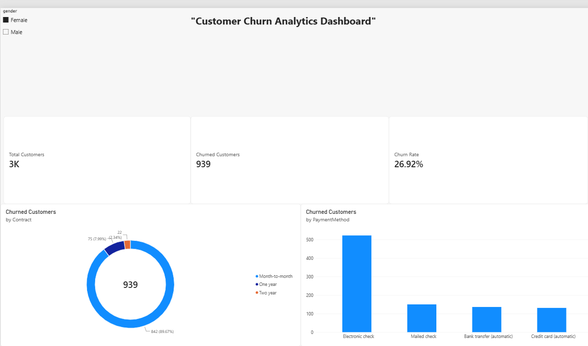

# 📊 Customer Churn Analytics Dashboard

## 📝 Project Overview
This project focuses on analyzing customer retention data to identify key factors driving customer churn. The project involves data cleaning using Python and building an interactive BI dashboard to visualize business insights, helping stakeholders make data-driven decisions.

## 🛠️ Tech Stack & Tools
* **Data Processing:** Python, Pandas (Jupyter/VS Code)
* **Data Visualization & BI:** Power BI
* **Calculations:** DAX (Data Analysis Expressions)

## 📸 Dashboard Preview

## 💡 Key Business Insights Discovered
1. **Contract Type:** Customers on a **Month-to-Month contract** have the highest churn rate compared to one-year or two-year contracts.
2. **Payment Method:** Customers paying via **Electronic Check** are significantly more likely to leave the service.
3. **Overall Retention:** The baseline churn rate stands at approximately 26.5% for the analyzed customer base.

## ⚙️ How to Run This Project
1. Clone this repository.
2. Open `cleaned_churn_data.csv` to view the processed dataset.
3. Open `churn_analysis_dashboard.pbix` in **Power BI Desktop** to interact with the dashboard.
